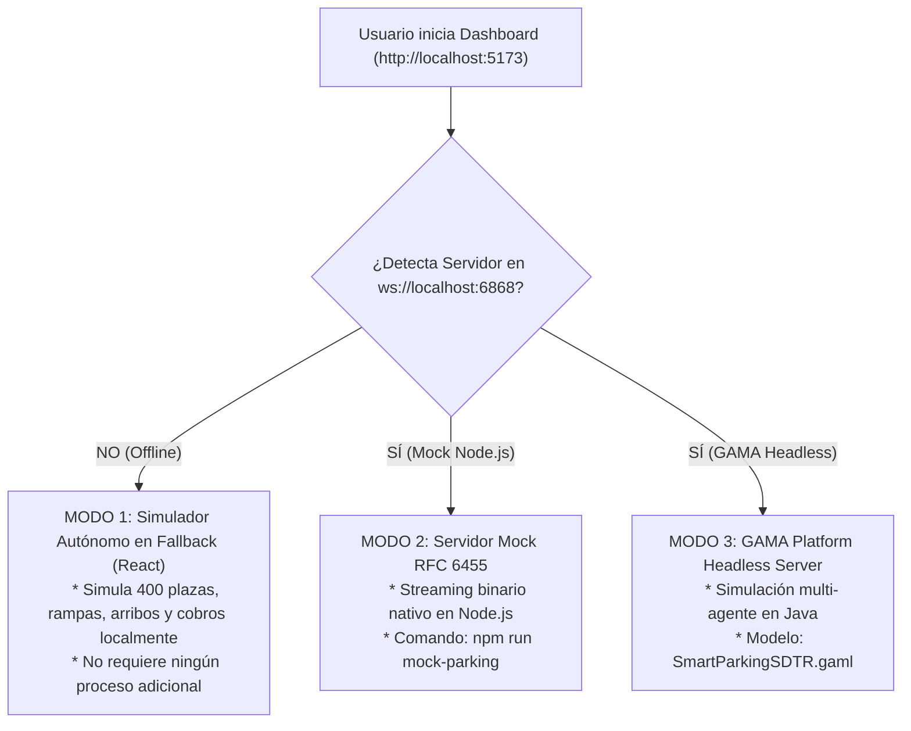

# 🚗 Sistema Distribuido de Tiempo Real (SDTR)
## Trabajo Integrador: Monitoreo y Control de Estacionamiento Inteligente Multi-Planta y Tráfico Urbano Multi-Agente

> **Cátedra:** Programación en Tiempo Real / Sistemas Distribuidos de Tiempo Real (SDTR)  
> **Tecnologías:** React 19 + Vite | Node.js (RFC 6455 WebSocket) | GAMA Platform (Modelado Multi-Agente)  
> **Arquitectura:** Soft Real-Time distribuido, control de concurrencia (Mutex de Dijkstra), despacho predictivo óptimo $O(N)$ y protocolo de evacuación WCET.

---

## 📋 Documentación de Referencia y Google Docs

Para la defensa de cátedra y estudio formal del proyecto, disponés de los siguientes documentos consolidados en este mismo repositorio:

| Documento | Formato | Propósito y Uso |
| :--- | :--- | :--- |
| **[`CONCEPTOS_Y_ARQUITECTURA_SDTR.md`](./CONCEPTOS_Y_ARQUITECTURA_SDTR.md)** | Markdown | Documento técnico maestro con fórmulas KaTeX, análisis de algoritmos y banco de preguntas del tribunal. |
| **[`CONCEPTOS_Y_ARQUITECTURA_SDTR.docx`](./CONCEPTOS_Y_ARQUITECTURA_SDTR.docx)** | MS Word / Google Docs | **Listo para subir a Google Drive:** Abrir en Google Docs con 1 clic preservando títulos, tablas y formatos. |
| **[`CONCEPTOS_Y_ARQUITECTURA_SDTR.html`](./CONCEPTOS_Y_ARQUITECTURA_SDTR.html)** | HTML Interactivo | Abrible en cualquier navegador con botón de **"📋 Copiar para Google Docs"**, diagramas Mermaid y opción para **Imprimir a PDF**. |
| **[`DOCUMENTACION_INTEGRACION_SDTR.md`](./DOCUMENTACION_INTEGRACION_SDTR.md)** | Markdown | Bitácora de integración de red, handshake GAMA Server y protocolo de telemetría. |

---

## ⚡ Guía de Inicio Rápido (Correr en VS Code en 2 Minutos)

### 1. Requisitos Mínimos
* **[Node.js](https://nodejs.org/)**: Versión 18.x o superior (se recomienda 20 LTS o 22 LTS).
* **[Visual Studio Code](https://code.visualstudio.com/)**: Cualquier versión reciente.
* **Navegador Web**: Google Chrome, Microsoft Edge, Firefox, Brave o Safari.

*(No es necesario tener instalado GAMA Platform para probar el sistema: el frontend incluye un motor de simulación local autónomo y un servidor mock de WebSocket en Node.js puro).*

---

### 2. Pasos de Instalación y Ejecución

#### Paso 1: Abrir el proyecto en VS Code
1. Abre **Visual Studio Code**.
2. Ve al menú superior: **`Archivo (File)` $\to$ `Abrir carpeta... (Open Folder...)`**.
3. Selecciona la carpeta raíz del proyecto (`tpIntegradorTiempoReal`).

#### Paso 2: Abrir la Terminal Integrada
* Presiona el atajo de teclado: **`` Ctrl + ` ``** (Ctrl + tilde/acento grave) o ve a **`Terminal` $\to$ `Nueva terminal`**.

#### Paso 3: Instalar Dependencias
En la terminal integrada, ejecuta el siguiente comando:
```bash
npm run setup
```
*(Este comando instala automáticamente todas las librerías de React 19 y Vite dentro de `web-dashboard`)*.

#### Paso 4: Iniciar la Aplicación
Ejecuta:
```bash
npm run dev
```

Verás una salida similar a:
```text
  VITE v8.2.2  ready in 140 ms

  ➜  Local:   http://localhost:5173/
  ➜  Network: use --host to expose
  ➜  press h + enter to show help
```

#### Paso 5: Abrir el Dashboard en el Navegador
* Haz **`Ctrl + Clic`** sobre el enlace `http://localhost:5173/` en la terminal, o abre tu navegador y entra a:
  **👉 [http://localhost:5173](http://localhost:5173)**

---

## 🛠️ Modos de Ejecución del Sistema

El proyecto está diseñado con **Tolerancia a Fallos y Degradación Grácil (*Graceful Degradation*)**, permitiendo 3 modos de ejecución según el entorno disponible:



### Modo 1: Autónomo / Fallback (Recomendado para pruebas inmediatas)
* **¿Qué requiere?**: Únicamente ejecutar `npm run dev`.
* **Cómo funciona**: Si el dashboard no detecta un servidor WebSocket en el puerto `6868`, activa de inmediato su **motor local de simulación y telemetría**. Puedes pausar, reanudar, inyectar vehículos manualmente, probar el despacho inteligente, detonar la alarma de evacuación WCET y simular el cobro de estadías sin abrir terminales extra.

### Modo 2: Con Servidor Mock de Telemetría (Node.js WebSocket RFC 6455)
Ideal para verificar la comunicación WebSocket distribuida sin necesidad de instalar la suite de GAMA:
1. En la primera terminal de VS Code:
   ```bash
   npm run dev
   ```
2. Abre una **segunda pestaña de terminal** (icono `+` en la consola de VS Code) y ejecuta:
   ```bash
   npm run mock-parking
   ```
   *(O si prefieres el modelo de tráfico macroscópico urbano: `npm run mock-traffic`)*.
3. El dashboard en `http://localhost:5173` mostrará en verde el indicador **`GAMA WS: CONECTADO (6868)`**.

### Modo 3: Con GAMA Platform (Simulación Multi-Agente Completa)
Si tienes **GAMA Platform** instalado en tu computadora:
1. Inicia GAMA Server en modo Headless en el puerto 6868:
   ```bash
   # En Windows:
   gama-headless.bat -socket 6868
   ```
2. O bien abre **GAMA GUI**, importa la carpeta `gama-traffic-simulation` como proyecto en el workspace, abre `models/SmartParkingSDTR.gaml` y dale a ejecutar el experimento `HeadlessParkingServer`.

---

## 🎯 Atajos con Tareas de VS Code (1 Clic)

El repositorio incluye la carpeta `.vscode/tasks.json`. Si no deseas escribir comandos en la terminal:
1. Presiona **`Ctrl + Shift + P`** en VS Code.
2. Escribe **`Tasks: Run Task`** (o en español **`Tareas: Ejecutar tarea`**).
3. Verás la lista de tareas preconfiguradas:
   * `1. Instalar Dependencias (Setup)`
   * `2. Iniciar Dashboard Web (React Vite)` *(Atajo predeterminado de compilación: `Ctrl + Shift + B`)*
   * `3. Iniciar Servidor WebSocket Mock (Parking)`
   * `4. Iniciar Servidor WebSocket Mock (Tráfico Urbano)`
   * `5. Iniciar Todo (Servidor Mock Parking + Web Dashboard)`

---

## 🗺️ Mapa de Vistas del Dashboard

Una vez abierto el dashboard en `http://localhost:5173`:

1. **Selector Superior de Vistas**:
   * **`OPERACIÓN EN TIEMPO REAL`**:
     * **Plano Vectorial 2D**: Visualización de las 100 plazas de la planta seleccionada (A, B, C, D) con semáforo cromático (verde libre, rojo ocupado, azul PMR, cyan EV).
     * **Cartelera de Aforo Digital**: Estado en vivo de ocupación por nivel.
     * **Control de Concurrencia en Rampas (Mutex de Dijkstra)**: Monitor de semáforos inter-planta con temporizadores de fase y estado de vaciado ámbar (`CLEARING`).
     * **Despacho Predictivo Inteligente (*Smart Dispatching*)**: Asignación automática óptima basada en función de costo $J(s)$ con cálculo de ETA en segundos.
     * **Panel de Evacuación Crítica y WCET**: Cronómetro de emergencia, medición analítica del tiempo de desalojo frente al deadline normativo de 180s y forzado de rampas a sentido descendente.
     * **Buscador de Vehículos y Cobro Digital**: Búsqueda por patente y liquidación con cuadro tarifario oficial (autos $1.400/h, 4x4 $2.800/h, estadías 12h/24h y descuentos PMR).
   * **`NOTIFICACIONES & AUDITORÍA`**:
     * Bitácora en tiempo real con estándar ISA-18.2 de severidades (`CRITICAL`, `WARNING`, `INFO`).
     * Alerta automática ante **Planta Completa (100% de ocupación)**.
     * Baliza sonora sintetizada en vivo con **Web Audio API**.
     * Pasarela Push para **WhatsApp Business Cloud API** y Webhooks.

---

## 📁 Estructura del Repositorio

```text
tpIntegradorTiempoReal/
├── .vscode/                               # Configuración automatizada para VS Code
│   ├── tasks.json                         # Tareas de compilación y ejecución a 1 clic
│   ├── launch.json                        # Perfiles de depuración F5 (Chrome/Node.js)
│   └── extensions.json                    # Extensiones recomendadas
├── CONCEPTOS_Y_ARQUITECTURA_SDTR.md       # Documentación técnica maestra formal
├── CONCEPTOS_Y_ARQUITECTURA_SDTR.docx     # Documento en formato Word para Google Docs
├── CONCEPTOS_Y_ARQUITECTURA_SDTR.html     # Vista HTML interactiva con botón para Google Docs
├── DOCUMENTACION_INTEGRACION_SDTR.md      # Detalles de comunicación de red y protocolos
├── package.json                           # Scripts globales del workspace
├── start-gama-headless.bat                # Script de inicio rápido para GAMA Server
│
├── mock-server/                           # Servidor WebSocket artesanal (Node.js puro)
│   ├── server.js                          # Mock para simulación macroscópica de calles
│   └── parkingServer.js                   # Mock para estacionamiento de 4 pisos
│
├── gama-traffic-simulation/               # Modelos GAML de simulación multi-agente
│   └── models/
│       ├── SmartParkingSDTR.gaml          # Modelo GAMA de 4 plantas y 400 plazas
│       └── RoadTrafficSDTR.gaml           # Modelo GAMA de arterias urbanas
│
└── web-dashboard/                         # Aplicación React 19 + Vite (Panel SCADA)
    ├── package.json                       # Dependencias frontend (React, Vite, ESLint)
    ├── src/
    │   ├── components/parking/            # Componentes de tiempo real del estacionamiento
    │   │   ├── ParkingDashboard.jsx       # Orquestador principal y motor reactivo
    │   │   ├── ParkingFloorPlan.jsx       # Render vectorial 2D (100 plazas x piso)
    │   │   ├── RampMutexIndicator.jsx     # Semáforos de exclusión mutua en rampas
    │   │   ├── EmergencyEvacuationPanel.jsx # Protocolo WCET y cronómetro crítico
    │   │   ├── ParkingNotificationCenter.jsx # Centro de auditoría y WhatsApp API
    │   │   └── ParkingBillingModal.jsx    # Modal de cobro y aplicación de tarifas
    │   ├── services/
    │   │   ├── gamaSocket.js              # Cliente WebSocket, reconexión y fallback
    │   │   └── notificationService.js     # Motor de alertas ISA-18.2 y Web Audio API
    │   └── utils/
    │       └── parkingDataHelper.js       # Algoritmos SDTR (Mutex, Costo J, WCET)
```

---

## ❓ Preguntas Frecuentes y Solución de Problemas (Troubleshooting)

### 1. ¿Qué hago si me dice `Error: listen EADDRINUSE: address already in use :::5173`?
Significa que ya tienes otra instancia de Vite corriendo en el puerto 5173. Vite automáticamente intentará abrir el siguiente puerto (por ejemplo `http://localhost:5174`). Puedes entrar a esa nueva URL o cerrar la terminal anterior con `Ctrl + C`.

### 2. En Windows PowerShell me aparece `No se puede cargar el archivo porque la ejecución de scripts está deshabilitada`.
Es una política de seguridad por defecto de Windows para PowerShell. Puedes solucionarlo abriendo PowerShell como Administrador y ejecutando:
```powershell
Set-ExecutionPolicy RemoteSigned -Scope CurrentUser
```
O simplemente cambiando el tipo de terminal en VS Code a **Command Prompt (`cmd.exe`)** o **Git Bash**.

### 3. ¿Necesito instalar GAMA Platform para ver el estacionamiento funcionando?
**No**. Gracias al diseño desacoplado de `gamaSocket.js`, si no inicias GAMA, el frontend arranca de manera autónoma con su simulador en fallback, permitiéndote interactuar con todas las funcionalidades de tiempo real, semáforos de rampa y despacho inteligente.

---
*Desarrollado para la Cátedra de Programación en Tiempo Real / Sistemas Distribuidos de Tiempo Real.*

